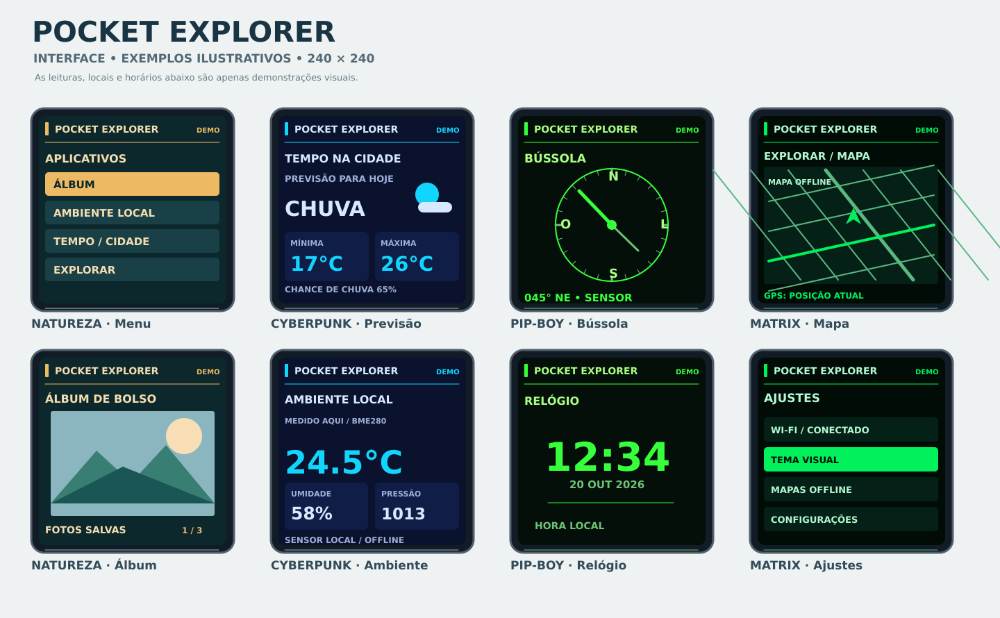
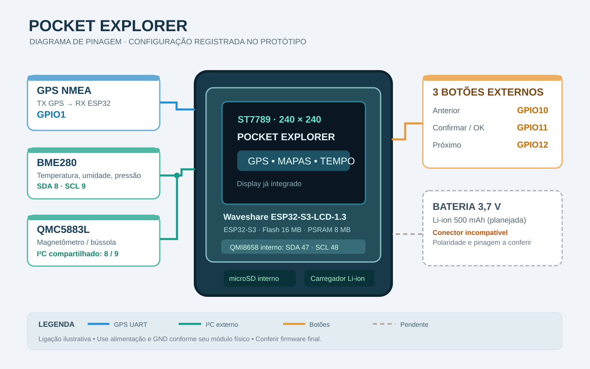

# Pocket Explorer · ESP32-S3

Gadget portátil multifuncional com **Waveshare ESP32-S3-LCD-1.3**, tela de **240×240**, GPS e sensores de ambiente/movimento.

> **Migração em andamento:** hardware, pinagem, funções e imagens de exemplo estão documentados. O código-fonte do Pocket Explorer **ainda não foi importado**; precisamos do ZIP/`.ino` da última versão funcional antes de publicar o firmware.



## Funcionalidades que planejamos/desenvolvemos

- **GPS e mapas:** localização atual, mapas armazenados no microSD, zoom e bússola/direção.
- **Ambiente local:** temperatura, umidade e pressão usando BME280.
- **Previsão do tempo:** situação atual e próximos dias, com ícones e temperaturas mínima/máxima.
- **Bússola:** direção e orientação via magnetômetro externo.
- **Relógio**, **álbum de imagens**, **menu** e **ajustes**.
- Visuais experimentais inspirados em Natureza, Cyberpunk, Pip-Boy e Matrix.
- Operação parcial offline (sensores/mapas em cache); Wi-Fi para previsão e sincronizações.

## Componentes principais

| Item | Uso |
| --- | --- |
| Waveshare ESP32-S3-LCD-1.3 | ESP32-S3, 16 MB Flash, 8 MB PSRAM, ST7789 240×240 |
| QMI8658 interno | Acelerômetro e giroscópio |
| microSD (slot interno) | Cache de mapas e fotos; 32 GB no protótipo |
| GPS NMEA externo | Latitude, longitude, horário/dados de navegação |
| BME280 externo | Temperatura, umidade, pressão |
| QMC5883L / variante a confirmar | Magnetômetro/bússola |
| 3 botões externos | Anterior, OK, próximo |
| Li-ion 3,7 V 500 mAh | Planejada; conector inicialmente incompatível |

### Pinagem conhecida

| Função | GPIO |
| --- | --- |
| GPS TX → ESP32 RX | **1** |
| I²C externo SDA / SCL | **8 / 9** |
| Botões anterior / OK / próximo | **10 / 11 / 12** |
| LCD interno (DC, CS, CLK, MOSI, RST, BL) | **38, 39, 40, 41, 42, 20** |
| QMI8658 interno SDA / SCL | **47 / 48** |

A pinagem externa é a registrada no desenvolvimento anterior; **validar com o firmware final e a montagem física**. Veja [pinagem completa, alimentação, cuidados e diagrama](docs/HARDWARE.md).



## Exemplo de interface

Os arquivos em `docs/images/` são **maquetes/diagramas de referência**, não fotos ou capturas de um firmware funcionando. Os dados, horários e leituras são fictícios.

Os exemplos anteriores do projeto também incluíram conjuntos de telas para os temas Natureza, Cyberpunk, Pip-Boy e Matrix. Quando disponível, exportar as imagens finais aprovadas pelo usuário para esta pasta.

## Organização inicial

```
.
├── README.md
├── AGENTS.md
├── .gitignore
└── docs/
    ├── HARDWARE.md
    ├── ESTADO_PROJETO.md
    └── images/
        ├── diagrama-conexoes.svg
        └── exemplos-telas.svg
```

Ao receber o ZIP original, ele será organizado em `src/` ou no layout nativo do Arduino IDE, preservando recursos necessários e adicionando instruções de instalação/teste.

## Documentação

- [Hardware e pinagem](docs/HARDWARE.md)
- [Estado do projeto e próximos passos](docs/ESTADO_PROJETO.md)
- [Instruções para Codex](AGENTS.md)

## Referência da placa

[Waveshare — ESP32-S3-LCD-1.3](https://www.waveshare.com/wiki/ESP32-S3-LCD-1.3) · [Esquemático oficial](https://files.waveshare.com/wiki/ESP32-S3-LCD-1.3/ESP32S3_1.3inch.pdf)
