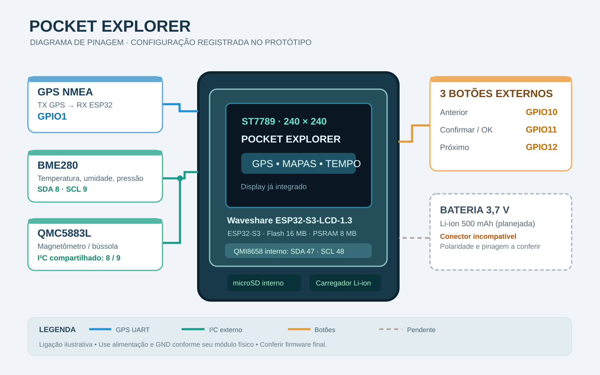

# Hardware e pinagem — Pocket Explorer

Este documento reúne a **pinagem registrada durante o desenvolvimento do Pocket Explorer** e as ligações internas conhecidas da **Waveshare ESP32-S3-LCD-1.3**. O sketch da versão final ainda precisa ser importado e confrontado com essas anotações.

> ⚠️ **Importante:** existem placas Waveshare com nomes parecidos e GPIOs diferentes. As tabelas abaixo se aplicam à **ESP32-S3-LCD-1.3 (tela quadrada ST7789)**, não às versões 1.28, 1.47, 1.85 etc.

## Visão geral

| Item | Modelo / descrição | Situação |
| --- | --- | --- |
| Placa principal | Waveshare ESP32-S3-LCD-1.3, ESP32-S3, 16 MB Flash, 8 MB PSRAM | Base do projeto |
| Tela | TFT ST7789 240×240, SPI, já integrada | Integrada |
| Sensor inercial | QMI8658: acelerômetro + giroscópio, integrado | Integrado |
| Armazenamento | Leitor microSD/TF integrado; cartão 32 GB usado no projeto | Integrado + cartão |
| GPS | Módulo GPS serial que entrega mensagens NMEA (modelo comercial exato não confirmado) | Externo |
| Temperatura/umidade/pressão | BME280, I²C (verificar identificação da peça física caso usada alternativa BMP280) | Externo |
| Bússola | Magnetômetro QMC5883L ou variante compatível — confirmar marcação | Externo |
| Botões | 3 botões para anterior / confirmar / próximo | Externos no planejamento |
| Alimentação portátil | Bateria Li-ion 3,7 V, 500 mAh pesquisada; **conector não compatível**, então ligação pendente | Não assumir instalada |

## Pinagem do protótipo — módulos externos

Esta é a pinagem anotada nas conversas anteriores; **conferir com o código .ino e a montagem física ao importar o firmware**.

| Função | GPIO ESP32-S3 | Conexão | Observações |
| --- | ---: | --- | --- |
| GPS — dados NMEA | **GPIO1** | TX do GPS → entrada RX do ESP32 | Comunicação UART; GND compartilhado |
| Sensor BME280 | **GPIO8 (SDA)** / **GPIO9 (SCL)** | I²C compartilhado | Tensão conforme módulo, preferir 3,3 V |
| Magnetômetro QMC5883L | **GPIO8 (SDA)** / **GPIO9 (SCL)** | Mesmo barramento I²C | Verificar identificação/endereço |
| Botão anterior | **GPIO10** | Botão externo | Configuração elétrica no sketch a confirmar |
| Botão confirmar | **GPIO11** | Botão externo | Configuração elétrica no sketch a confirmar |
| Botão próximo | **GPIO12** | Botão externo | Configuração elétrica no sketch a confirmar |

### Ligações de alimentação

- **Unificar todos os GNDs** entre placa, GPS, BME280 e bússola.
- Validar a tensão permitida pelo **módulo GPS específico** antes de alimentá-lo. Não assumir 5 V ou 3,3 V sem conferir sua placa.
- Preferir módulos I²C compatíveis com lógica **3,3 V**; não aplicar sinal de 5 V diretamente aos GPIOs da ESP32-S3.
- As linhas I²C precisam de pull-ups adequados; alguns módulos já possuem resistores, e múltiplos módulos podem alterar o valor efetivo.
- A interface da bateria na placa é tipo MX1.25 conforme Waveshare; conferir conector, pinagem, polaridade, proteção e carregamento antes de conectar qualquer bateria.

## Pinagem interna da placa (não precisa ligar fios)

| Sinal interno | GPIO |
| --- | ---: |
| LCD ST7789 — DC | **38** |
| LCD ST7789 — CS | **39** |
| LCD ST7789 — SCK | **40** |
| LCD ST7789 — MOSI | **41** |
| LCD ST7789 — RST | **42** |
| LCD — backlight | **20** |
| QMI8658 — I²C SDA | **47** |
| QMI8658 — I²C SCL | **48** |

**Atenção:** o barramento I²C **externo** (GPIO8/9) registrado no projeto é **diferente** do barramento do IMU interno (GPIO47/48). Não alterar os dois como se fossem um único barramento.

O leitor microSD é integrado. **Os GPIOs internos do microSD e da leitura de bateria serão registrados após conferir o firmware final/esquemático desta revisão**, para evitar documentar uma pinagem possivelmente incorreta. Não exige fios externos para uso do slot.

## Diagrama simplificado

O diagrama é **ilustrativo**. Identifica os sinais e GPIOs anotados no projeto, mas não substitui a conferência da sua montagem física.

## Software e bibliotecas já discutidos

- **Arduino IDE** com pacote de placas ESP32 da Espressif.
- Display **ST7789**, com bibliotecas gráficas compatíveis (a implementação exata deverá ser conferida no .ino final).
- **TinyGPS++** para análise de frases NMEA do GPS.
- Acesso ao microSD para mapas/imagens.
- I²C / `Wire` para sensores de ambiente e bússola.
- Wi-Fi para consultar previsão do tempo; uso offline para dados locais e mapas baixados.
- **Não** tratar dependências como definitivas antes da importação do firmware original.

## Fontes e limites

- [Waveshare — página oficial da ESP32-S3-LCD-1.3](https://www.waveshare.com/wiki/ESP32-S3-LCD-1.3)
- [Waveshare — esquema oficial da placa](https://files.waveshare.com/wiki/ESP32-S3-LCD-1.3/ESP32S3_1.3inch.pdf)
- Anotações das sessões anteriores do Pocket Explorer: GPIO1 GPS, GPIO8/9 I²C externo, GPIO10/11/12 botões.

**Pendente:** checar pinagem do microSD, bateria, modelo exato do GPS e magnetômetro contra as peças físicas e o firmware final.
